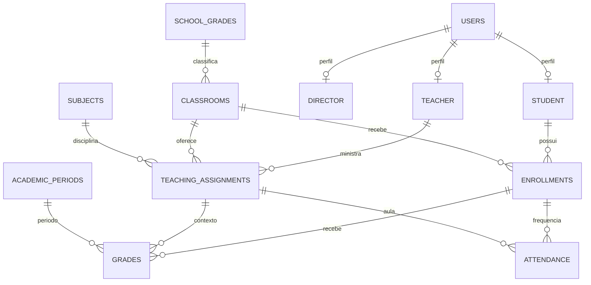

# Diagrama do modelo de dados

Diagrama conceitual baseado nas relações declaradas nas entidades JPA atuais. Ele não representa uma migração SQL nem substitui o schema real do banco.

## Notas de leitura

- Cada `Student`, `Teacher` ou `Director` possui uma referência única a `User`. O lado inverso é opcional no mapeamento JPA.
- As relações desenhadas como um-para-muitos representam o lado “muitos” com `@ManyToOne`; em alguns pontos o código não declara coleções no lado um.
- `Classroom.academicYear` é um número guardado diretamente na turma. Não existe entidade `AcademicYear` no modelo Java atual.
- `AcademicPeriod` não está ligado a ano acadêmico no código atual.
- A tabela de presença chama-se `attendance` (singular); as demais tabelas são as indicadas nas anotações `@Table`.
- O projeto usa `school_grades` para o catálogo de etapas escolares, enquanto “grade” (tabela `grades`) é nota. Não confunda série escolar com nota.

Veja também [[Exemplos de Dados]] e [[Comandos Java Spring]].
